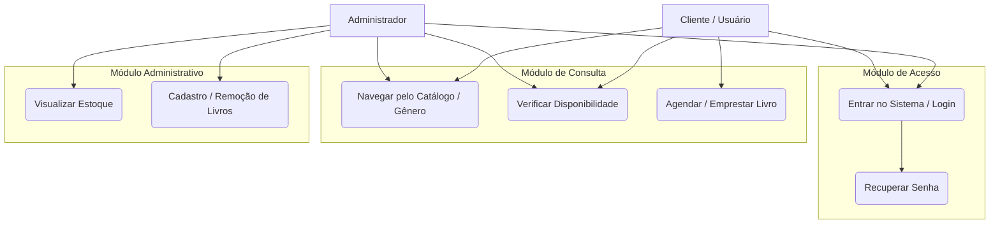

# BIBLIOTEC
#<h2> BIBLIOTEC</h2>

Integrantes: Bianca e Leonardo Agripino 
Tema: Biblioteca 
Objetivo: Um aplicativo para ajudar na gestão de uma biblioteca 
Tecnologias: C# e Banco de Dados 
Descrição: Um app para desktop que auxilia o gerenciamento de uma biblioteca, tanto na parte administrativa, gerenciando o cadastro de livros e controle de estoque, quanto na parte da freguesia, onde será possível visualizar a disponibilidade dos livros, o agendamento, e a devolução.  

## Requisitos do Sistema

<h2>Requisitos Funcionais:</h2> 
-senhas 
-classificação 
-cadastro 
-inserção livros 
-remover livros 
-emprestar livros 
-recuperação de senha 
-catalogo 
-ver se está disponível 
-agendar livros  

<h2>Requisitos não Funcionais:</h2> 
-layout limpo e com pouca poluição visual 
-personalização 
-comentário 
-algoritimo de recomendação 
-avaliação do livro  
---

## Perfis de Usuário
* **Administrador:** Acesso total à gestão de estoque e cadastro de itens.
* **Cliente:** Acesso à consulta de acervo, agendamento e disponibilidade.

## Diagrama de Caso de Uso

<h2>Telas</h2> 

-Login 
-catalogo 
-cadastro/remoção de livros 
-visualização de estoque 
-agendar 
-recuperar senha 
Aplique aqui
