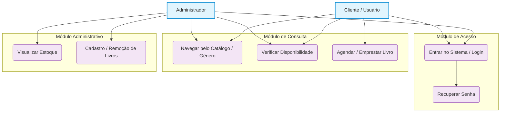

# BIBLIOTEC

**Integrantes:** Bianca e Leonardo Agripino  
**Tema:** Gestão de Biblioteca  
**Tecnologias:** C# e Banco de Dados  

---

## Objetivo
Desenvolver um aplicativo desktop intuitivo para auxiliar na gestão de bibliotecas. O sistema atende tanto a administração — gerenciando o cadastro de livros e controle de estoque — quanto os clientes, permitindo consultar o catálogo, verificar disponibilidade e realizar agendamentos.

---

## Requisitos do Sistema

### Requisitos Funcionais (RF)
* **Autenticação:** Login seguro e recuperação de senha.
* **Gestão de Acervo:** Cadastro, edição, inserção e remoção de livros.
* **Consulta e Catálogo:** Visualização organizada com filtros por gênero e status de disponibilidade.
* **Operações de Usuário:** Empréstimo e agendamento de livros.

### Requisitos Não Funcionais (RNF)
* **Design:** Layout limpo e com poluição visual reduzida.
* **Experiência do Usuário:** Algoritmo de recomendação, sistema de avaliação de livros e campos de comentários.
* **Personalização:** Opções para ajustar a interface conforme a necessidade.

---

## Perfis de Usuário
* **Administrador:** Acesso total à gestão de estoque e cadastro de itens.
* **Cliente:** Acesso à consulta de acervo, agendamento e disponibilidade.

---

## Diagrama de Caso de Uso

<h2>Telas</h2> 

-Login 
-catalogo 
-cadastro/remoção de livros 
-visualização de estoque 
-agendar 
-recuperar senha 
Aplique aqui
